# KonukDefteri

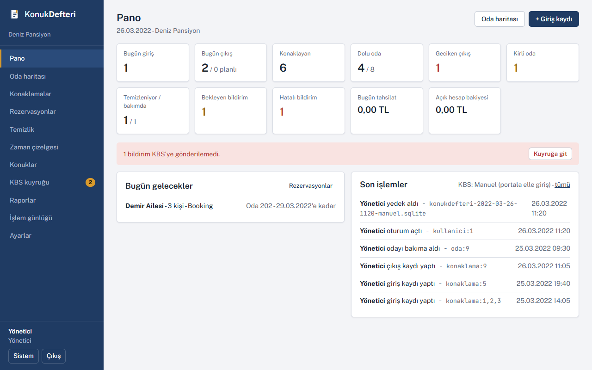

Türkiye'de konaklayan herkesin kimliğini aynı gün kolluğa bildirmek zorunlu (1774 sayılı Kimlik Bildirme Kanunu). Büyük oteller bunu otel programıyla yapıyor; küçük pansiyonda iş, resepsiyondaki deftere yazıp akşam KBS sayfasına tek tek girmek. Unutulan konuk, yanlış yazılan TC, sistem çöktüğünde ne yapılacağının bilinmemesi... Bu program o defterin yerine geçsin diye yazıldı. Konuk kartı bir kere açılır, giriş çıkış kaydedilir, bildirim kendiliğinden kuyruğa düşer ve gider. KBS'ye ulaşılamıyorsa bildirim bekler, servis açılınca sırayla gönderilir.

Program tesisin kendi bilgisayarında çalışır (Node.js + SQLite), aynı ağdaki tablet ya da ikinci bilgisayar tarayıcıdan bağlanır. Veri dışarı çıkmaz; internet yalnızca KBS'ye gönderim için lazım.

## Neler yapıyor

- Konuk kartı: TC kimlik ya da pasaport. TC numarası veritabanında şifreli durur (AES-256-GCM), ekranda son 4 hanesi görünür; tamamını yalnızca yönetici açar ve bu günlüğe yazılır.
- Giriş, çıkış, oda değişimi. Aile ya da grup tek işlemde girer. Gece konaklama ya da günübirlik (saatlik) kullanım, planlanan çıkış, geciken çıkış uyarısı.
- KBS bildirimi: her giriş, çıkış ve oda değişimi bir bildirim satırı üretir. Jandarma bölgesinde web servisiyle otomatik gönderim; Emniyet bölgesinde "manuel mod": portala girilecek alanlar kopyalanmaya hazır gelir, girildikten sonra "bildirildi" işaretlenir. Hangi konuğu bildirdim, hangisini unuttum sorusu böylece kalmıyor.
- Gönderilemeyen bildirim kuyrukta bekler, iki dakikada bir yeniden denenir, hata mesajı satırda görünür. KBS'nin çalışmadığı aralık için kesinti tutanağı yazdırılır.
- Oda haritası: katlar şerit şerit, odalar kutu kutu, kutunun üst kenarı durumu söyler (dolu, boş, kirli, temizleniyor, bakımda, bugün rezerve). Tıklayınca oda paneli: kim var, kaç saattir, planlanan çıkış, temizlik, son 30 gün.
- Temizlik: çıkış yapan oda kendiliğinden kirli olur ve görev açılır; kat görevlisi telefonundan "başladım / bitti" der. Kirli odaya giriş engellenir, yönetici bile bile yerleştirirse günlüğe düşer.
- Rezervasyon: liste ve oda x gün tahtası, tarih çakışması kontrolü, kaynak (telefon, Booking, Airbnb, kapıdan). "Geldi" deyince giriş kaydı açılır.
- Zaman çizelgesi, gün ya da hafta görünümü. "Bu oda dün 15:00'te kimdeydi" diye sorulunca bakılan yer.
- Hesap: odanın gecelik / günübirlik fiyatından konaklama kalemi açılır, gece sayısı çıkışta kesinleşir. Ekstra ve indirim kalemleri, nakit / kart / havale tahsilat, çıkışta kalan ya da iade, fiş, günlük kasa raporu. Fatura değil, tesisin kendi hesabı.
- Konuğun imzaladığı kayıt formu yazdırılır, altında KVKK metni var (ayarlardan değişir).
- Raporlar: günlük konaklayan listesi (karakolun istediği biçimde, yazdırılır), aylık giriş çıkış özeti, uyruk dağılımı, doluluk, kasa.
- Kara liste: sorun çıkaran konuk kartta işaretlenir, girişte nedeniyle uyarı çıkar, yalnız yönetici zorla alabilir.
- Yedek: her gece belirlenen saatte alınır, en yeni on dört tanesi tutulur, geri yükleme aynı ekrandan. Pano yedek alınmamışsa uyarır.
- Üç rol var: yönetici, resepsiyon, kat görevlisi. Kat görevlisi konuk bilgisi görmez. İşlem günlüğü kim ne zaman ne yaptı diye tutuyor.
- Açık ve koyu tema. Resepsiyonda bilgisayar, kat görevlisinde telefon.

## Ekran görüntüleri

| | |
|---|---|
| 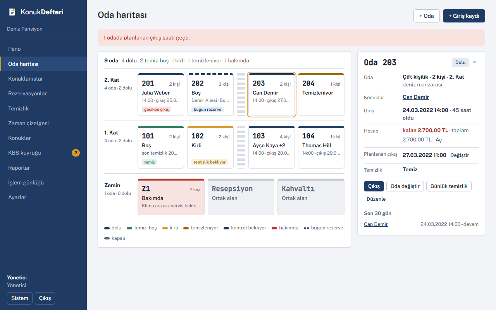 Oda haritası | 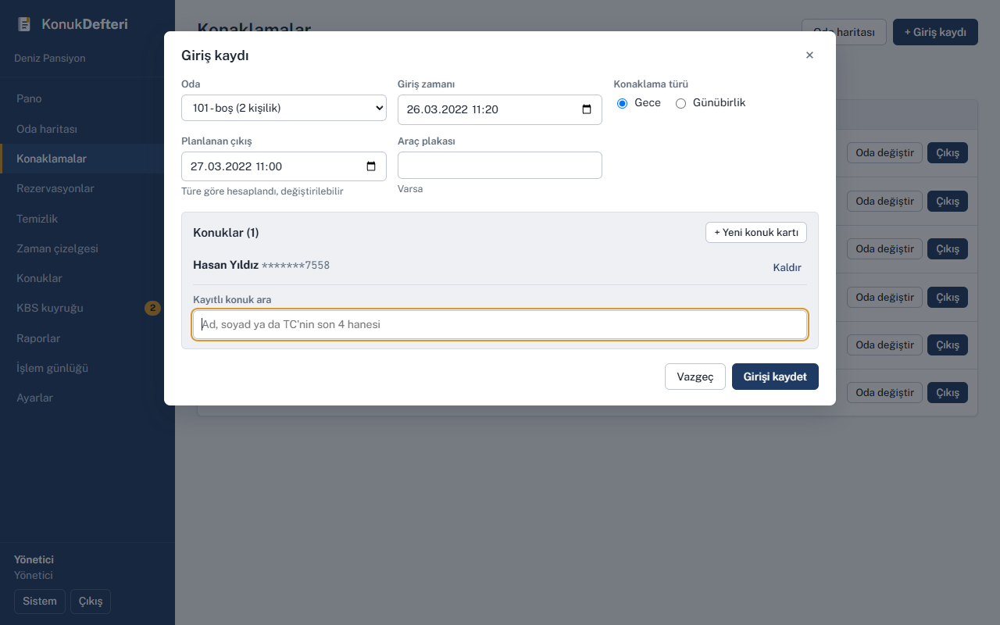 Giriş kaydı |
| 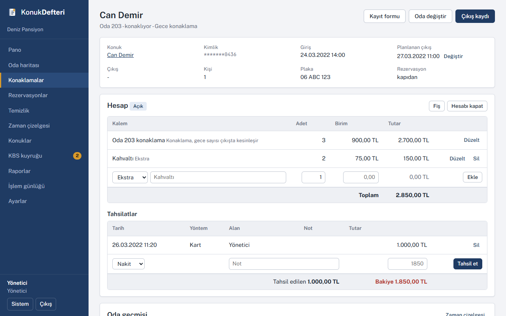 Konaklama ve hesap | 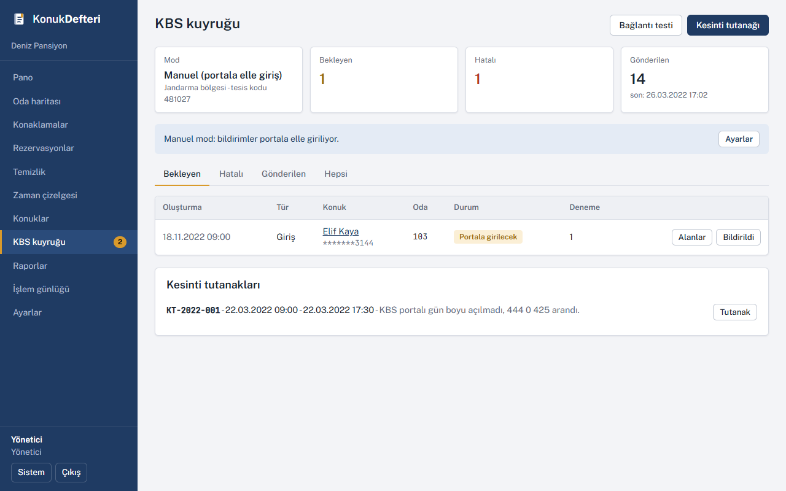 KBS kuyruğu |
| 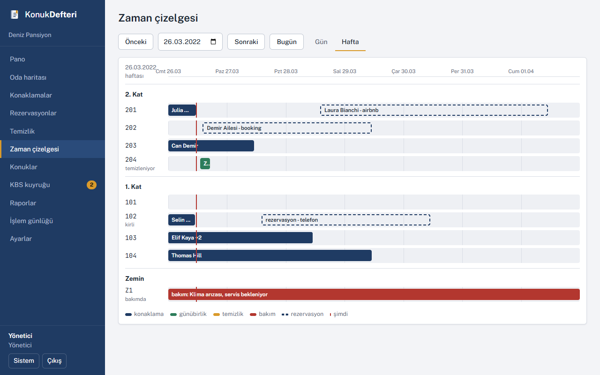 Zaman çizelgesi | 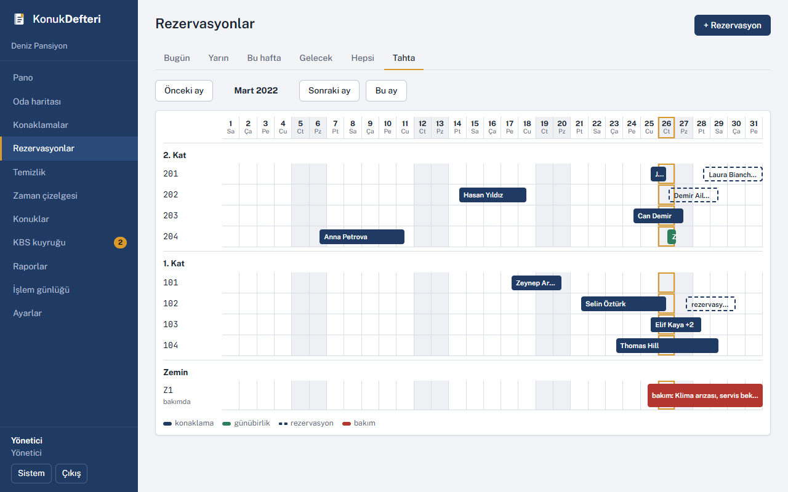 Rezervasyon tahtası |
| 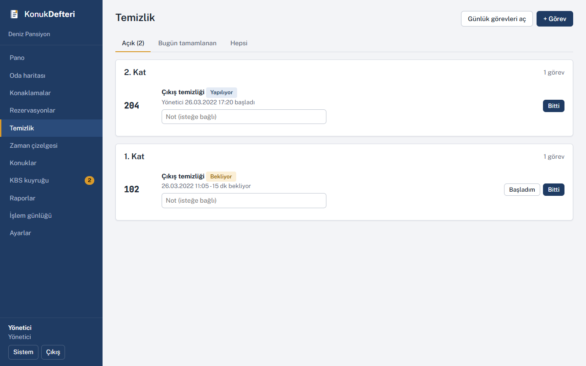 Temizlik | 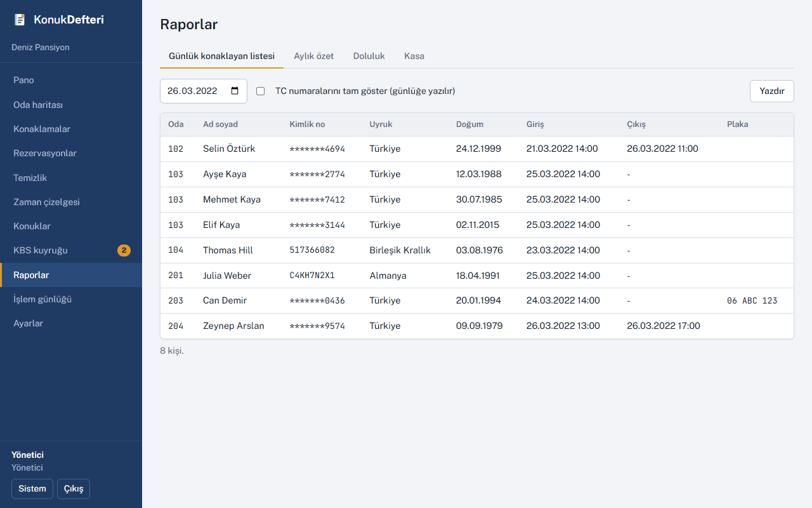 Günlük konaklayan listesi |
| 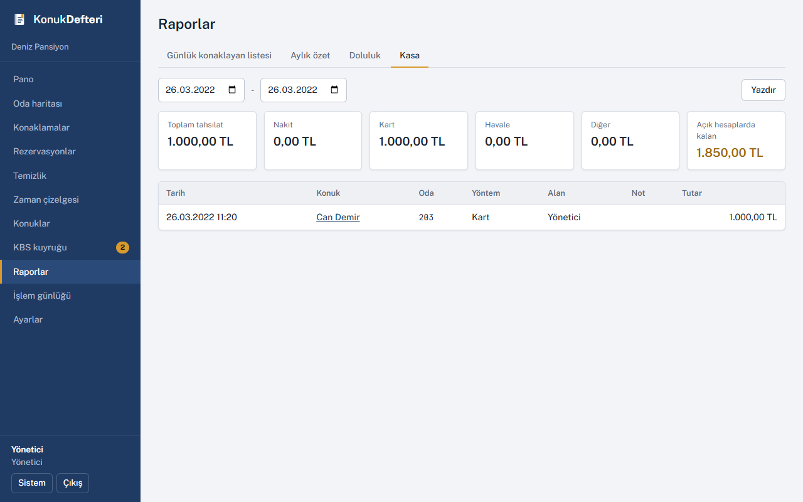 Kasa | 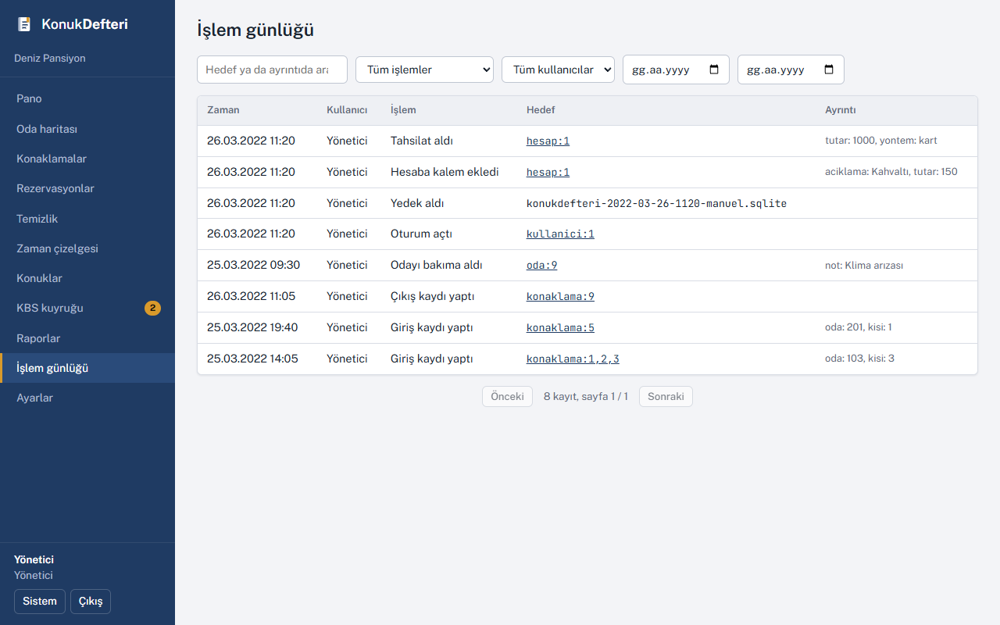 İşlem günlüğü |
| 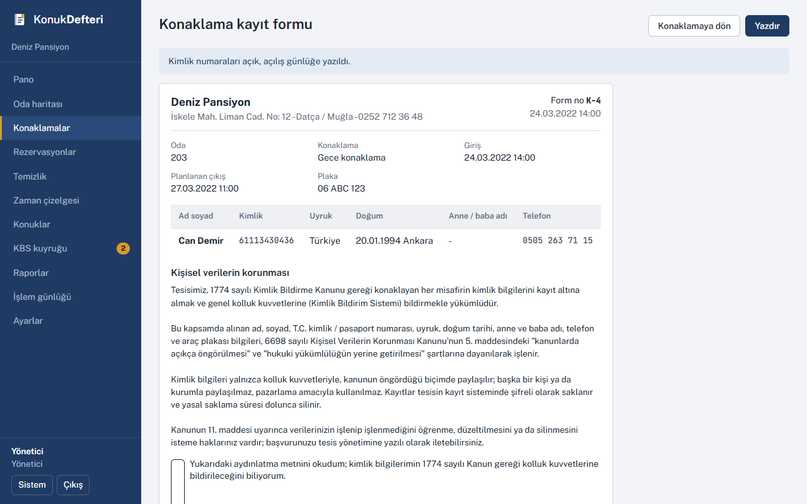 Kayıt formu | 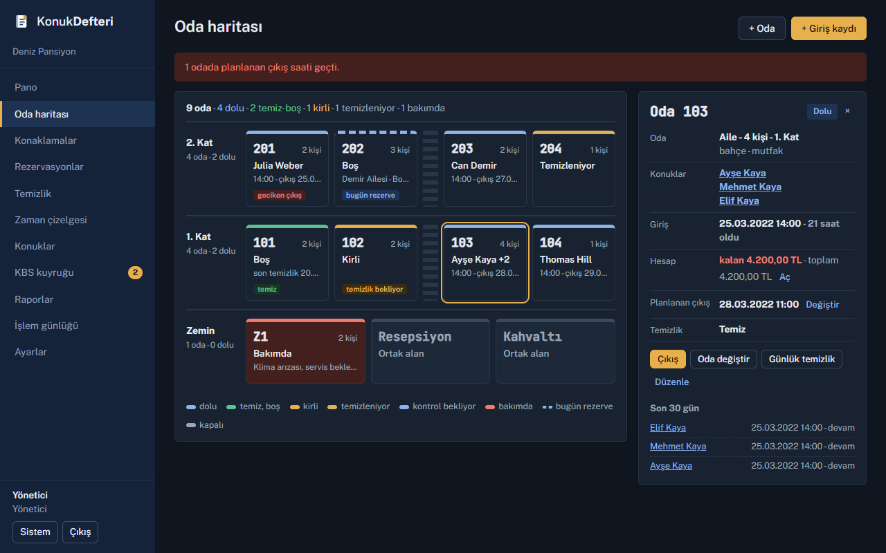 Koyu tema |

## Kurulum

Gereken: Windows 10 ya da 11 (Linux'ta da çalışıyor, Mac'te denemedim), Node.js 16 ve biraz boş alan. Jandarma web servisi kullanılacaksa internet ve karakola bildirilmiş sabit IP.

```bash
git clone https://github.com/Kadirify/KonukDefteri.git
cd KonukDefteri
npm run kur
copy .env.example .env
npm run anahtar
```

`npm run anahtar` iki satır üretir (`JWT_GIZLI` ve `SIFRE_ANAHTARI`), bunları `.env` içine yapıştırın. `SIFRE_ANAHTARI` kaybolursa kayıtlı TC numaraları bir daha okunamaz, bir yere not edin.

Çalıştırmak için:

```bash
npm run build
npm start
```

Tarayıcıdan `http://localhost:3001` açılır. Aynı ağdaki cihazlar için sunucu açılışta kendi adresini yazar (`http://192.168.1.20:3001` gibi). Bilgisayar her açıldığında kendiliğinden başlasın isterseniz Görev Zamanlayıcı ve NSSM ile servis olarak çalıştırma [docs/kurulum.md](docs/kurulum.md) içinde.

### İlk açılış

Kullanıcı adı `yonetici`, parola `.env` içindeki `YONETICI_PAROLA`. İlk girişte parolayı değiştirmeniz istenir. Sonra sırayla:

1. Ayarlar > Tesis ve KBS: tesis adı, karakolun verdiği 6 haneli tesis kodu, Emniyet mi Jandarma mı, adres.
2. Ayarlar > Katlar ve odalar: katlar (en üst kat en üstte), odalar ve fiyatları.
3. Ayarlar > Kullanıcılar: resepsiyon ve kat görevlisi için ayrı kullanıcı. Herkes kendi adıyla girsin ki günlük bir işe yarasın.
4. Ayarlar > Genel ve Yedekleme: giriş çıkış saatleri, temizlik kuralı, KVKK metni, yedek saati ve klasörü.

Denemek için `npm run ornek` boş veritabanına örnek bir pansiyon yükler; ekran görüntülerindeki veri bu.

## KBS bağlantısı

Tesis hangi birime bağlıysa ona göre:

- Emniyet (belediye sınırı içi): kbs.egm.gov.tr portalı, programda manuel mod. Tesis kodu ve kullanıcı yeter.
- Jandarma (köy, yayla, kırsal): web servisi. Tesis kodu, web servis yetkili kullanıcı (TC) ve şifresi, karakola bildirilmiş sabit IP gerekiyor.

Jandarma web servisi için karakoldan tesis kodu alınır, KBS'de web servis yetkisi olan bir kullanıcı tanımlanır ve o kullanıcı için IP tanımı yapılır. Bilgiler Ayarlar > Tesis ve KBS'ye girilir, "Bağlantı testi" ile denenir. Servis adresi (WSDL) `.env` içinde ya da ayarlardan verilir.

Manuel modda program yine her olay için bildirim satırı üretir; satırdaki "Alanlar" düğmesi portala girilecek bilgileri kopyalanabilir şekilde gösterir, giriş yapıldıktan sonra "Bildirildi" ile kapatılır.

Geliştirirken gerçek servise gerek yok: `npm run mock:kbs` aynı metot adlarıyla cevap veren sahte bir Jandarma servisi açar (şifre `123456`, `MOCK_KAPALI=1` ile "sistem bakımda" davranışı). `http://localhost:3002/` adresinde sahte sunucuya gelen bildirimler listelenir.

## Teknik

```
server/   Express 4, knex + sqlite3, joi, jsonwebtoken (httpOnly cookie), winston, node-cron, soap
client/   Vite 2, React 17, react-router 6, react-hook-form, axios. UI kiti yok, CSS elle yazıldı.
```

- Tek SQLite dosyası; migration'lar açılışta kendiliğinden çalışır. SQLite tek bağlantıyla çalışıyor: transaction içinde ikinci bir `db(...)` çağrısı kilitleniyor, `trx` geçirmek şart. Bunu öğrenene kadar epey uğraştım.
- Oda durumu üç ayrı eksen: doluluk konaklamalardan hesaplanır, temizlik ve kullanılabilirlik (bakımda, kapalı) odada tutulur. Oda değişimleri `konaklama_odalari` tablosunda segment olarak saklanır, çizelge oradan okur.
- KBS sürücüleri `server/src/services/kbs/` altında: `manuel.js` ve `jandarma.js` (SOAP). Emniyet için bir gün servis açılırsa aynı `gonder` / `test` arayüzüyle eklenir.
- Testler jest + supertest, her test dosyası kendi geçici veritabanıyla açılır: `npm test`.
- Geliştirme: `npm run dev` ile API (3001) ve Vite (3000) birlikte, `/api` proxy ile.

## Eksikler

- Emniyet tarafında web servis yok, manuel mod kullanılıyor.
- Jandarma servisinin istek alan adları karakoldan gelen dokümanla birebir doğrulanmadı; metot adları doğru, alanlar `jandarma.js` içinde tek yerde.
- Kimlik okuyucu (MRZ) yok, elle giriş.
- Fatura ve e-arşiv yok, fiş bilgi amaçlı.
- Booking ve Airbnb bağlantısı yok, rezervasyonlar elle girilir.
- Saklama süresi dolan kayıtların silinmesi elle.
- Tek tesis.
